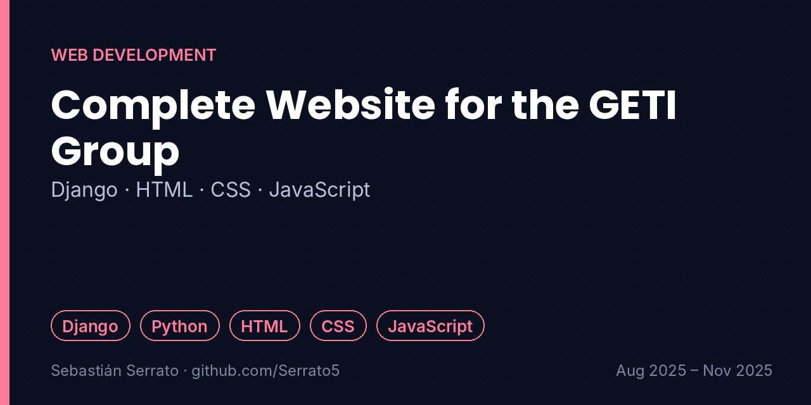
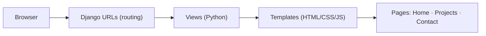

# Complete Website for the GETI Group

**Django · HTML · CSS · JavaScript**

`Django` `Python` `HTML` `CSS` `JavaScript`

## Overview

Academic web project for the Programming II course (Faculty of Engineering, Universidad Surcolombiana): a clean, multi-page web platform for the GETI group.

## Key features

- **Structure and navigation:** Complete site with multiple interconnected pages, including Home, Projects and Contact.
- **Backend:** Server setup, routing and structured logic with the Django framework (Python).
- **Frontend:** Layout in HTML, visual styling in CSS and interactive client-side components in JavaScript.
- **Scalability:** Modular architecture designed as a base for later data-management features.

## How it works

## What I learned

- How a request travels through Django: URL → view → template.
- Separating structure, style and behavior on the frontend.
- Planning a project so later features fit in without rewrites.

## Project context

| | |
|---|---|
| Context | Programming II · Universidad Surcolombiana |
| Dates | Aug 2025 – Nov 2025 |
| Area | Web Development |
| Related project | [registro-estudiantes-mongodb](https://github.com/Serrato5/registro-estudiantes-mongodb) |

## Resumen en español

Sitio web completo para el grupo GETI en el curso de Programación II: varias páginas conectadas (Inicio, Proyectos, Contacto), backend con Django y frontend con HTML, CSS y JavaScript, con una arquitectura modular para crecer.

---

**About this repository:** the original source code and design files of this project were not preserved. This repository documents what was built, how it works and what I learned, based on my project records. It does not contain reconstructed code.

**Sobre este repositorio:** el código y los archivos originales de este proyecto no se conservaron. Aquí se documenta qué se construyó, cómo funciona y qué aprendí, sin código reconstruido.

**Author:** Sebastián Serrato Ramírez · Electronic Engineering student, Universidad Surcolombiana (Neiva, Colombia) · [LinkedIn](https://www.linkedin.com/in/sebaserrato) · [More projects](https://github.com/Serrato5)
